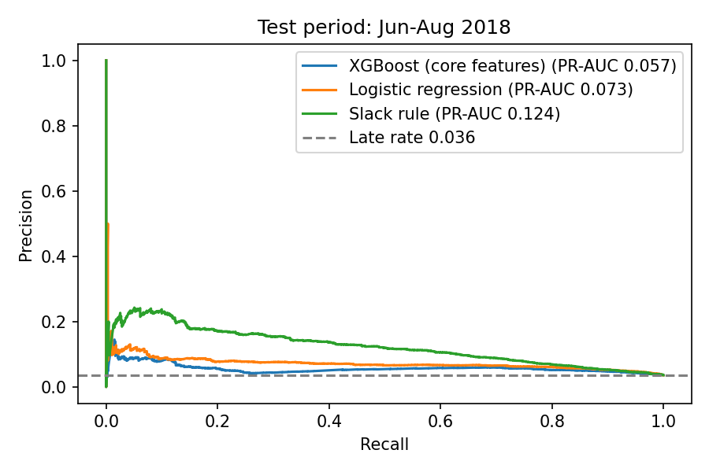
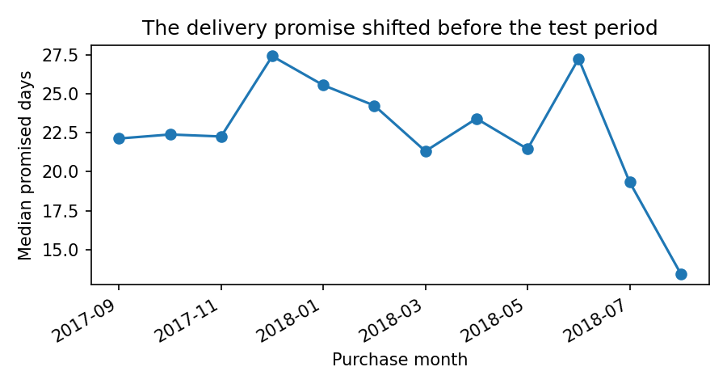

# Late Delivery Prediction: When a Simple Rule Beats XGBoost

Can an online marketplace flag orders likely to arrive late, at the moment they are placed, so a team can step in early?

I tested this on about 96,000 real orders from the [Olist Brazilian e-commerce dataset](https://www.kaggle.com/datasets/olistbr/brazilian-ecommerce), using SQL, XGBoost and a strict time-based split.

**Main finding:** on the final three months, a one-line rule beat every model I trained. The likely cause is a change in the business: the delivery window promised to customers shrank sharply during that period, into a range the models had rarely or never seen.

## Results

Test period: June to August 2018, with 18,603 orders, of which 672 (3.6%) were late. The model trained on 71,494 earlier orders.

| Approach | PR-AUC | ROC-AUC | Late orders caught in the riskiest 10% |
|---|---:|---:|---:|
| Random guess (baseline) | 0.036 | 0.500 | 10.0% |
| XGBoost, first attempt (19 numeric and 4 categorical features) | 0.035 | 0.497 | 8.0% |
| XGBoost, final (5 core features) | 0.057 | 0.651 | 16.5% |
| Logistic regression (all features) | 0.073 | 0.709 | 21.6% |
| **Slack rule (no training)** | **0.124** | **0.774** | **38.4%** |

The slack rule ranks orders by the promised delivery time minus the average time that seller-to-customer route has recently taken. Least margin goes first.

Its PR-AUC lead over the final XGBoost is well outside noise: the 95% bootstrap interval for the XGBoost-minus-rule difference is -0.085 to -0.052.



### Read these results carefully

- **The final XGBoost row is not a blind test.** The first attempt failed on the test period, and I then changed the model. I chose the replacement using only earlier data and fixed it before re-running, then stopped, but I had already seen those outcomes. The baseline, first-attempt XGBoost, logistic regression and slack rule were all set before that first look and did not change.
- **The rule is not always better.** On the three earlier backtests, it averaged a lower PR-AUC (0.119) than XGBoost with core features (0.162). The rule won in the period when conditions changed, which is one three-month window.
- **Late orders are a moving target.** The monthly rate ranges from 1.2% to 19.0%, so PR-AUC is not comparable between periods.
- **XGBoost's probabilities were poorly calibrated in the test period.** Its Brier score (0.0397) was worse than always predicting the historical late rate (0.0354), so its output should not be read as a true probability.

## What went wrong, and how I found it

The first model had the most features and was tuned on validation data, yet it scored no better than chance on the test period.

I investigated using a rolling backtest on data from before the test period, then compared input values over time:



The median promised window fell from about 27 days in June 2018 to about 13 days in August. Tree models cannot extrapolate beyond values seen in training, which most likely explains the failure: they had little basis for handling promises this tight. A simple margin calculation needs no training on that range. This fits the evidence, but I did not run an experiment that proves it.

Backtest averages across three earlier periods, which is what the model choice was based on:

| Approach | Mean PR-AUC | Mean ROC-AUC |
|---|---:|---:|
| XGBoost, core features (chosen) | 0.162 | 0.654 |
| XGBoost, no rate features | 0.160 | 0.661 |
| XGBoost, no network rate | 0.157 | 0.655 |
| XGBoost, all features | 0.155 | 0.657 |
| Logistic regression | 0.151 | 0.638 |
| Slack rule | 0.119 | 0.604 |
| Average late rate (baseline) | 0.086 | 0.500 |

The differences between the XGBoost variants are small, so the choice between them is not strong evidence.

## What I would tell the business

1. **Start with the rule.** It is cheap, easy to explain, and in the latest period caught 38% of late orders by reviewing only 10% of them.
2. **Add monitoring before adding a complex model.** Tracking the promised window would have warned that the models were out of their depth.
3. **Find out why the promise changed.** The data does not explain the drop. Someone in operations probably can, and it may matter more than any model.
4. **Validate further before relying on this.** The rule's win needs confirming on later data.

## Preventing leakage

Only information available at purchase is used, and approval, carrier and delivery dates and reviews are excluded.

- **History features only use finished orders.** A seller's late rate counts only orders delivered before the current order was purchased. `tests/test_features.py` checks this.
- **The split follows time.** Training and validation orders still in transit when the next period starts are dropped.
- **Known limitation:** cancelled and undelivered orders are excluded because their delivery outcome is unknown. A live system would see those at purchase too.

## SQL analysis

`sql/features.sql` builds the modelling table using CTEs and `ROW_NUMBER()`. `sql/analysis.sql` answers business questions using `LAG()`, `RANK()`, joins and `HAVING`. Results are in [`reports/sql_analysis.md`](reports/sql_analysis.md).

- Every one of the ten worst routes with at least 200 orders starts in São Paulo, which also has by far the most sellers. `SP > AL` is worst, at 23.8% late.
- Late rates spiked to 12.4% in November 2017 and 19.0% in March 2018.

## Run it yourself

Requires Python 3.10+. Download the dataset from Kaggle and save the zip as `data/raw/olist.zip`. The data is not included in this repo.

```bash
python -m venv .venv
.venv/Scripts/activate        # macOS/Linux: source .venv/bin/activate
pip install -r requirements.txt

python src/build_db.py        # load the CSVs into SQLite
pytest -q tests               # leakage checks
python src/run_analysis.py    # SQL analysis
python src/train.py           # first attempt, kept so its failure can be reproduced
python src/diagnose.py        # rolling backtest on pre-test data
python src/final_eval.py      # locked final evaluation
```

## Project structure

```text
sql/features.sql      Builds one row per delivered order
sql/analysis.sql      Business questions
src/build_db.py       Loads the CSVs into SQLite
src/features.py       Point-in-time history features
src/train.py          First attempt
src/diagnose.py       Rolling backtest and drift check
src/final_eval.py     Final evaluation
tests/                Leakage checks
reports/              Metrics, charts and SQL results
```
